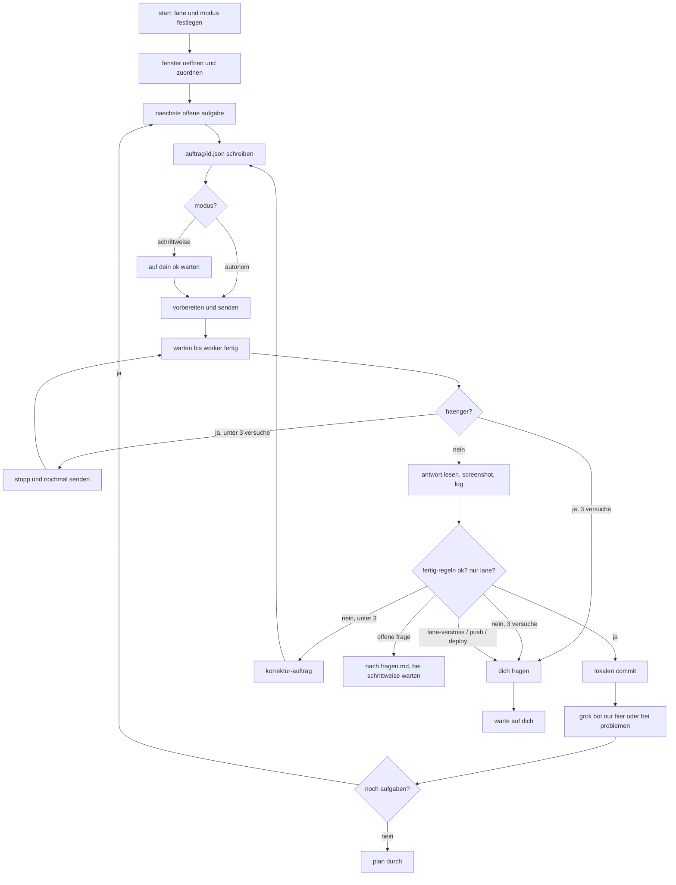

# plan: director- und worker-loop

grok bot ist der director (handy, schaut z.b. alle 15 min nach). cursor-fenster auf dem pc sind die worker. zusammen sollen damit groessere projekte gebaut werden.

nur eigener code: python, comtypes, pillow. keine fremden agent-frameworks. baut auf tipper.py auf. der loop ist gebaut (loop.py, tipper.py). dieser plan bleibt die verbindliche regel.

## neue dateien

`loop.py` laeuft auf dem pc von allein:

- naechste offene aufgabe aus `.loop/plan.json` nehmen
- `auftrag/<id>.json` schreiben
- ins zugeordnete cursor-fenster `vorbereiten` + `senden --ja` (siehe modus unten)
- `warten`, bis der worker fertig ist
- `antwort/<id>.json` lesen, ergebnis speichern, screenshot (`bild`), `log.md` ergaenzen

dazu ein befehl, der neue cursor-fenster oeffnet: `cursor -n <ordner>`. das muss erst getestet werden (ob wirklich ein neues fenster fuer genau diesen ordner aufgeht, und wie wir es danach in der fensterliste wiederfinden).

der rest bleibt tipper.py / window_order.py. grok bot startet den loop nicht selbst, sondern schaut per routine nur nach, was der pc gemacht hat.

## ordner .loop/ im projekt

liegt fest in der lane (dem projektordner, der am start gesetzt wird), z.b. `projekt/.loop/`:

```
.loop/
  plan.json          # die aufgaben
  auftrag/<id>.json  # director -> cursor
  antwort/<id>.json  # cursor schreibt zurueck
  log.md             # was passiert ist
  fragen.md          # gesammelte fragen an dich
  status.json        # kurzer stand fuer grok bot (aktuell, fertig, offen, fragen, letzter_fehler, zeit)
```

befehle:

- `loop.py init --lane <ordner> --modus schrittweise|autonom`
- `loop.py aufgabe --lane ... --id t1 --ziel "..." --fenster <hwnd>`
- `loop.py schritt --lane ...`  (vorbereiten, nicht senden)
- `loop.py senden --lane ... --ja`  (senden, warten, antwort, bild, log, ggf. lokaler commit)
- `loop.py lauf --lane ... [--ja]`  (alle offenen aufgaben nacheinander; schrittweise stoppt vor jedem senden; autonom nur wenn plan.json modus=autonom, und nur mit --ja)
- `loop.py status --alle`  /  `tipper.py status`  (ein json aller register-projekte)
- `loop.py modus --lane ... --modus autonom`
- `loop.py commit --lane ... --auftrag <id> --art fenster|cli`  (--auftrag bleibt pflicht)

vor jedem tippen und senden: hwnd und fenstertitel pruefen, bei abweichung die aufgabe abbrechen. mehrere fenster nacheinander, nie gleichzeitig. jede aufgabe bekommt `arbeit/<id>` von main/basis, nicht von einem anderen arbeit-branch.

`plan.json` hat die aufgaben, jede mit:

- `id`
- `ziel` (was gebaut werden soll)
- `dateien` (wo der worker arbeiten darf)
- `fertig_wenn` (wann die aufgabe durch ist)
- `verboten` (was er nicht darf)
- `fenster` (welches cursor-fenster, nummer)
- `status` (`offen`, `laeuft`, `korrektur`, `fertig`, `frage`, `blockiert`)
- `versuche` (zaehler, max 3)

plus oben am plan: lane (projektordner), modus (`schrittweise` oder `autonom`), wie viele fenster.

## nachrichten zwischen den kis

kurz, nur json, keine prosa-mauern. cursor bekommt den auftrag als datei und soll am ende genau eine antwort-datei schreiben.

### auftrag (director -> cursor), beispiel `auftrag/t1.json`

```json
{
  "id": "t1",
  "art": "auftrag",
  "ziel": "start/stop-button fuer die rotation oben links",
  "dateien": ["maske/ansicht.js", "maske/ansicht.css"],
  "fertig_wenn": "klick startet und stoppt, keine fehler in der konsole",
  "verboten": ["nichts ausserhalb der lane", "kein git push", "kein deploy"],
  "hinweis": "nur in diesem projektordner. lokal committen macht der loop, nicht du. nichts pushen. am ende antwort/t1.json schreiben."
}
```

### antwort (cursor -> director), beispiel `antwort/t1.json`

```json
{
  "id": "t1",
  "status": "fertig",
  "geaenderte_dateien": ["maske/ansicht.js", "maske/ansicht.css"],
  "tests": "ok",
  "offene_fragen": [],
  "kurz": "button ist drin, start/stop geht"
}
```

`status` in der antwort: `fertig`, `korrektur_noetig`, `frage`, `blockiert`.
`offene_fragen` wandern nach `fragen.md`.

## regeln

- **lane:** der projektordner wird am start festgesetzt. der worker bleibt darin.
- aenderungen oder loeschungen ausserhalb der lane, `git push`, deploy, irgendwas oeffentliches: immer erst dich fragen. nie still machen.
- **start:** der loop fragt dich einmal: schrittweise freigabe oder autonom?
  - *schrittweise:* vor jedem `senden` wartet er auf dein ok (wie bisher: `senden` nur mit `--ja` nach ok im chat).
  - *autonom:* du sagst einmal ja fuer diese runde. dann darf der loop in der lane selbst `senden --ja` ausfuehren. ausserhalb der lane, push, deploy bleibt tabu.
- **autonom fertig:** eine aufgabe gilt nur als fertig, wenn die festen regeln passen: tests gruen, startet ohne fehler, diff nur innerhalb der lane. offene fragen sammelt er in `fragen.md`, statt dich dauernd zu pingen.
- **fragen-modus:** wenn etwas unklar ist oder eine regel dich braucht, wartet er. die frage steht in `fragen.md` mit mehreren antwort-optionen (multiple choice), plus "anders, ich schreibs selbst".
- **max 3 korrektur-runden** pro aufgabe, dann dich fragen (status `frage` / `blockiert`).
- nach jeder fertigen aufgabe: automatisch nur **lokaler** commit, kein push.
- anzahl der cursor-fenster wird pro projekt am start festgelegt.
- **handy:** grok bot schaut z.b. alle 15 min in log, antworten, fragen, screenshots. er schreibt dir nur bei meilensteinen (aufgabe oder plan durch) und bei problemen (haenger, 3x schief, frage, lane-verstoss). nicht bei jedem kleinen schritt.
- **haenger:** `warten` merkt, dass nichts mehr weitergeht. dann `stopp`, auftrag nochmal senden, `versuche` hochzaehlen. nach 3 mal: dich fragen.

## ablauf



## bauschritte

1. `cursor -n <ordner>` testen: fenster auf, richtiges projekt, in der liste von `tipper.py fenster` auffindbar. (erledigt)
2. `.loop/` anlegen und die json-formate festziehen (plan, auftrag, antwort). (erledigt)
3. `loop.py` fuer **eine** aufgabe: auftrag schreiben, vorbereiten, senden (erst schrittweise), warten, antwort lesen, `bild`, log. (erledigt)
4. fertig-regeln, 3 korrekturen, haenger-erkennung (`warten` + `stopp` + nochmal senden). (erledigt: `lauf` und `nach_senden`)
5. modus schrittweise vs autonom, `fragen.md` mit multiple choice, warten auf antwort. (erledigt)
6. automatischer lokaler commit nach fertiger aufgabe, lane-schutz (diff pruefen, bei verdacht fragen). (erledigt)
7. mehrere fenster pro projekt, zuordnung in `plan.json`, hwnd/titel vor typ und send pruefen. (erledigt, nacheinander)
8. grok-bot-routine (z.b. 15 min): `loop.py status --alle` oder `.loop/status.json` lesen, aber nur bei meilenstein oder problem schreiben.

erster test: ein kleines uebungsprojekt, **streng in dieser lane**. eine kleine, klare aufgabe, schrittweise, ein fenster. wenn das sauber laeuft, erst dann autonom und mehr fenster.

## offene risiken

- cursor aendert die oberflaeche (eingabefeld, stop-knopf, fenstertitel). dann bricht tippen, warten und lesen.
- mehrere fenster klauen sich den fokus. text kann im falschen fenster landen. deshalb vorher fest zuordnen und nach dem senden kurz pruefen.
- der wechsel in den ask-modus klappt noch nicht zuverlaessig. plan- und ask-aufgaben erst lassen, bis das sitzt, oder den modus manuell setzen.
- `cursor -n` ist ungetestet: vielleicht oeffnet es kein zweites fenster, oder zu langsam, oder mit anderem titel.
- `senden --ja` im autonomen modus: nur nach deiner einmaligen start-freigabe, und nur in der lane. die tipper-regel selbst bleibt.
- screenshots und logs koennen interne pfade enthalten. nicht committen, nicht pushen. `.loop/` lokal halten, zumindest `antwort`, screenshots und `log.md` nicht oeffentlich machen.
